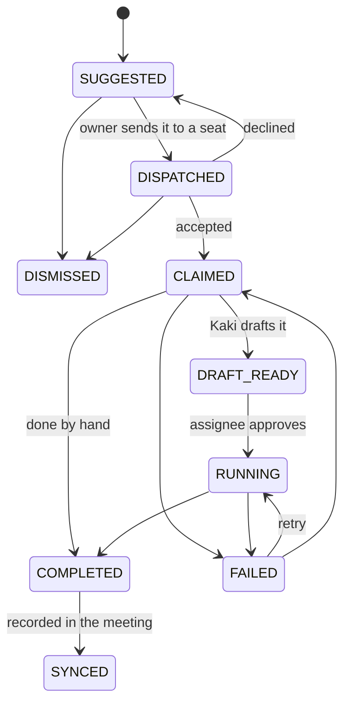

# Kaki

A meeting assistant that gives every seat a private wingman.

[Try Kaki](https://green-sky-0c9a41800.4.azurestaticapps.net) · [Demo video](#demo-video) · [Screenshots](#screenshots) · [Architecture](#architecture) · [Setup automation](#setup-automation) · [Contents](#contents) · [Poster](docs/poster/kaki-a1-poster.pdf)

### Demo video

https://github.com/user-attachments/assets/a58a7483-8770-4e9d-8917-85835a87b9cb

*Two minutes of a practice meeting: Kaki hosts, the wingman briefs Alex before they answer, and the tasks Alex decides on become a Gitea issue, Mattermost posts, an email, a calendar event and wiki minutes, each approved first.*


*A team meeting in progress: the owner and a guest, with Kaki's agenda, live transcript and a follow-up card in the side panel.*

Kaki (Singlish for "buddy" or "one of us") helps a small team run a meeting and finish the work it creates. Each person holds their own seat with a private wingman, while a neutral host keeps the clock and the notes. Follow-ups become to-do cards that a person can hand to Kaki to draft, and the minutes and to-dos stay in the workspace after the meeting ends. A practice meeting, where AI colleagues fill the other seats, is one click away at `/practice` with no sign-in.

## Highlights

- Sign in with Google to get a personal workspace; Nanyang Kopi, a ready-made read-only workspace for a fictional café chain with its tools already connected, lets anyone try Kaki without connecting their own.
- A workspace connects Mattermost, Gitea, a wiki, email and a calendar, stores their logins encrypted, and tests each connection with one button.
- A meeting can start now or be scheduled, with an agenda that is typed, drafted by Tell Kaki or taken from the calendar.
- Guests join by link or QR code under their own name, without an account.
- Many meetings run at once, each with its own notes, transcript and cards.
- Every person's wingman answers "what did I miss?" from the meeting first and then from workspace records, with sources and dates.
- A to-do card can be done for you: Kaki drafts the issue, post, email, wiki page or calendar event, and nothing is written until a person approves it.
- After the meeting, the workspace keeps the minutes and to-dos, with Copy, Download and a tick for each to-do.
- Meetings are speech only, and the layout works on a phone.
- A signed-in person can delete their account and everything in it; the [privacy policy](https://green-sky-0c9a41800.4.azurestaticapps.net/privacy.html) says what Kaki keeps.

## Screenshots

<table>
  <tr>
    <td align="center"><br><sub>Choose a team meeting or a practice meeting.</sub></td>
    <td align="center"><br><sub>The join screen on a phone.</sub></td>
  </tr>
  <tr>
    <td align="center"><br><sub>The same meeting on a guest's phone.</sub></td>
    <td align="center"><br><sub>The minutes and to-dos stay in the workspace after the meeting.</sub></td>
  </tr>
  <tr>
    <td align="center" colspan="2"><br><sub>The always-on start page wakes the cloud server on demand.</sub></td>
  </tr>
</table>

## Team

| Name | Matriculation number | Area |
| --- | --- | --- |
| Xiao Xiao | A0332142W | Kaki Host |
| Joshua Lum Zi Yuan | A0108499N | Kaki Wingman |

## Contents

1. [Try it](#try-it)
2. [Problem statement](#problem-statement)
3. [Architecture](#architecture)
4. [Front-end features](#front-end-features) and [Back-end features](#back-end-features)
5. [Sign-in and sessions](#sign-in-and-sessions)
6. [Setup automation](#setup-automation)
7. [Integration with third-party services](#integration-with-third-party-services)
8. [Usability and invalid-input handling](#usability-and-invalid-input-handling)
9. [Code structure and library components](#code-structure-and-library-components), [Built with React](#built-with-react) and [Technology choices](#technology-choices)
10. [Testing and evaluation](#testing-and-evaluation)
11. [Open source and licensing](#open-source-and-licensing) and [Borrowed code and credits](#borrowed-code-and-credits)
12. [Competitors](#competitors) and [Business model](#business-model)
13. [Project management](#project-management)
14. [Repository structure](#repository-structure)
15. [Sources](#sources)

## Try it

Start at **[green-sky-0c9a41800.4.azurestaticapps.net](https://green-sky-0c9a41800.4.azurestaticapps.net)**. This start page is always on. Kaki itself runs on an Azure virtual machine (VM) that switches itself off when idle, so it costs nothing between meetings. If the VM is off, choosing an option on the start page wakes it, which takes a minute or two.


*The start page wakes the VM on demand; a timer on the VM switches it off again when nobody is around.*

- The start page's two small functions can only read the VM's state and start it.
- Every 5 minutes a check on the VM reads Kaki's idle state from a route only the VM itself can reach.
- The VM switches itself off after 60 minutes with nobody connected, or after 2 hours with nobody speaking or clicking (a forgotten open tab).
- If the check cannot read Kaki's state, the VM stays on and switches off only after 2 hours of that.
- A meeting cut off this way is saved and comes back when the VM wakes.

### A team meeting

1. Sign in with Google. The account menu lists your personal workspace and the read-only Nanyang Kopi workspace.
2. In a workspace, connect the tools you want (Mattermost, Gitea, wiki, email, calendar), or use the ones already connected in Nanyang Kopi.
3. Open New meeting, describe the meeting to Tell Kaki or take the agenda from your calendar, then start it now or schedule it.
4. Share the invite link or QR code. Guests join from any browser, including a phone, under their own name.

Each person has their own seat under their own name (two people called Sam show as "Sam" and "Sam (2)"), and no AI colleagues join. The room can go off the record, anyone can leave and rejoin, and the owner or an admin can end the meeting for everyone.

### A practice meeting

Open [/practice](https://kaki.southeastasia.cloudapp.azure.com/practice). Each visitor gets their own room, the AI colleagues take the other seats, and the visitor takes part by speaking. A signed-in visitor keeps the minutes and to-dos in their own Nanyang Kopi history; a signed-out visitor reads the minutes on the Nanyang Kopi wiki and is invited to sign in to keep future meetings.

### Links and logins

| What | Where | Login |
| --- | --- | --- |
| Kaki app (workspaces and team meetings) | [kaki.southeastasia.cloudapp.azure.com](https://kaki.southeastasia.cloudapp.azure.com) | Sign in with Google |
| Practice meeting with AI colleagues | [/practice](https://kaki.southeastasia.cloudapp.azure.com/practice) | None |
| Wiki.js | [Port 8081](http://kaki.southeastasia.cloudapp.azure.com:8081) | `demo` / `demo` |
| Gitea | [Port 8082](http://kaki.southeastasia.cloudapp.azure.com:8082) | `demo` / `demo`, or `wei-ling`, `arjun`, `mei`, `daniel` with password `demo` |
| Mattermost | [Port 8443](https://kaki.southeastasia.cloudapp.azure.com:8443) | `demo` / `demo`, or `weiling`, `arjun`, `mei`, `daniel` with password `demo` |
| Mailpit inbox | [Port 8084](http://kaki.southeastasia.cloudapp.azure.com:8084) | None |
| Radicale calendar | [Port 5232](http://kaki.southeastasia.cloudapp.azure.com:5232) | `demo` / `demo` |

These are shared accounts on the hosted stack, and they hold only the fictional company's data.

The fictional colleague Wei Ling is `wei-ling` in Gitea and `weiling` in Mattermost, because the seed creates each tool's admin account under the name that tool accepts (`docker/seed/env.ts`). To run Kaki on your own machine, see [Setup automation](#setup-automation).

## Problem statement

A meeting host has to present, watch the clock, keep the agenda and record who agreed to do what, and a hybrid meeting makes each of those harder. When the person who knows the answer stays quiet, the question can sit open for the rest of the call.

Zoom AI Companion 3.0 drafts tasks and emails inside Zoom, and Otter.ai Live Assist gives private coaching tips while the call runs. The harder problems are deciding when to stay silent, who needs which fact, and how to write into another system without surprising anyone. Kaki splits those jobs between a neutral host, a private wingman for each participant and an action agent that writes into the team's own tools.

The hard problems are overlapping speech, timing and privacy. Several people can talk at once, and each microphone is transcribed separately, so the transcript has to keep their lines apart. A follow-up should not be sent until its agenda item is settled, and a private card must reach only one seat. In a practice meeting the AI colleagues have to take turns and stop when someone interrupts. A real meeting adds many people at once, guests with no account, and a room that can go off the record.

We think private help during a live meeting will become as ordinary as the automatic recap is today, and that teams will expect a meeting to leave finished work behind.

## Architecture


*Browsers talk only to the Kaki server and to LiveKit; every model, speech and company-tool call is made on the server side.*

The browser holds no API keys. It reaches LiveKit, the real-time audio server, with a room token issued by the Kaki server. Every LLM call, Azure Speech call and company-tool write is made by the server or by the AI runner (the NPC runner in the table below).

One server process runs many meetings. The meeting registry loads each meeting on demand, gives it its own notes, transcript, tasks and socket audience, and caps how many are open at once. Meeting state is saved to Postgres, so a restart restores each meeting where it was. Company records sit in the same database, with pgvector (a Postgres extension for similarity search over embeddings), so a question can match a record by meaning as well as by its words.

| Agent | What it does | Code |
| --- | --- | --- |
| Kaki Host | Runs the agenda clock, keeps the meeting record, finds open questions and follow-ups, dispatches work to the right person and triggers the closing summary. | `server/src/host/` |
| Kaki Wingman | A private helper for one person. It answers "what did I miss?" and other questions from the meeting first and the workspace second, notes a to-do given to them, flags a direct question they must answer, and surfaces a record that answers or contradicts the discussion. Guests get meeting-only answers. | `server/src/wingman/` |
| Kaki Action | Drafts an issue, post, email, wiki page or calendar event after a person presses Do it for me or claims the task, and runs it once they approve. At the end it drafts the minutes for a person to approve before anything is written to the wiki. | `server/src/action/` |
| NPC runner and Director | The runner joins every room as a silent listener for speech-to-text (STT). In a practice meeting it also plays the AI colleagues, which the code calls NPCs: one Director speaks for all of them, one at a time, through Azure text-to-speech (TTS), and stops when someone talks over it. | `server/src/npc/` |

### The path of one follow-up

When someone says "I'll email the supplier", the notetaker turns the line into a follow-up, the owner sends it to that person's seat, and the email goes to the team's mail server only after a person approves the draft. In the hosted stack that mail server is Mailpit; each workspace sets its own SMTP host when it connects email.


*From a spoken line to an email in the team's mail server, with a person in charge at every step that changes something.*

| Step | Code |
| --- | --- |
| Notetaker proposes the follow-up and keeps the source line | `server/src/host/notetakerTasks.ts` |
| Owner dispatches it to a seat | `server/src/host/autoDispatch.ts` |
| Card is published to that seat only | `server/src/meeting/tasks.ts`, `web/src/meeting/room/ActiveRoleCards.tsx` |
| Draft is checked against its source and run | `server/src/action/runner.ts`, `server/src/action/draftGrounding.ts` |
| Email reaches the team's mail server (Mailpit in the hosted stack) | `server/src/action/email.ts` |

## Front-end features

The web app is one React and Vite application. Shared colour and type tokens and a shared component set (`Button`, `Card`, `StatusPill`, `Avatar`, `RejectionBanner`) keep the pages consistent. In the meeting room the stage takes most of the space and private cards sit in a dock beside it; on a phone the stage stacks above the dock and the controls stay at the bottom.

| Route | Who | What |
| --- | --- | --- |
| `/` | Anyone | Landing page: sign in, start a team meeting, try a practice meeting or enter a meeting code. A signed-in person goes straight to `/new`. |
| `/signin` | Anyone | Google sign-in, returning to the page named in `next` or to `/new`. |
| `/new` | Signed in | Create a meeting now or for later, with a typed agenda, a Tell Kaki draft or a calendar import. |
| `/workspaces/:id` | Members | The workspace's meetings and tools; an admin connects, tests and disconnects tools. |
| `/workspaces/:id/meetings/:meetingId` | Members | Minutes and to-dos of an ended meeting, with Copy, Download and a tick per to-do. |
| `/m/:id` | Anyone with the link | Guest join page. |
| `/m/:id/room` | Joined people | The team meeting room. |
| `/practice` | Anyone | This visitor's own practice meeting. |

Any other path redirects to `/`. The account menu signs out, or deletes the account once the person types DELETE to confirm.

Code: `web/src/App.tsx`, `web/src/product/`, `web/src/ui/tokens.css`, `web/src/ui/`

### Plan the meeting (front end)

On `/new` a person chooses a workspace, types the title and agenda, or asks Tell Kaki for a draft or imports the agenda from the calendar, then presses Start now or Schedule for later. Field errors appear next to the input. The workspace page lists its meetings and each connected tool, with connect, save, test and disconnect controls for an admin.

Code: `web/src/product/NewMeetingPage.tsx`, `web/src/product/api.ts`, `web/src/product/WorkspacePage.tsx`, `web/src/product/ToolSection.tsx`

### Invite and join (front end)

The meeting bar shares the invite link and a QR code and lists who has joined. A guest opens the link, enters a name and joins; a scheduled meeting can be joined early. A reload or a dropped connection restores the same name and seat while the grace window is open. The practice join form takes a name and a seat and checks the microphone and camera.

Code: `web/src/meeting/room/RealMeetingBar.tsx`, `web/src/product/JoinPage.tsx`, `web/src/meeting/room/rejoinSession.ts`, `web/src/meeting/room/JoinForm.tsx`

### During the meeting (front end)

The stage shows each person's video tile, who is speaking, live captions and reaction badges; in a practice meeting the AI colleagues appear as animated orbs. The dock holds the role card, agenda clock, transcript, task board, the private Wingman panel and any private task card. The meeting bar has microphone and camera controls, Off the record, Invite, People and Leave, plus End for everyone for the owner or an admin, and a banner shows while the room is off the record. Audio controls show a live level, and a phone can tap to start playback when the browser blocks it.

Nobody types into the room. The only text box is the private Ask Kaki box, whose answer goes to that person alone. One hook holds the WebSocket connection, the event window, the task list and the send function.

Code: `web/src/meeting/room/MeetingGrid.tsx`, `web/src/meeting/room/CaptionedTile.tsx`, `web/src/meeting/room/Orb.tsx`, `web/src/meeting/room/stageModel.ts`, `web/src/meeting/room/Dock.tsx`, `web/src/meeting/room/RoleCard.tsx`, `web/src/meeting/room/WingmanPanel.tsx`, `web/src/meeting/room/MeetingPanel.tsx`, `web/src/meeting/room/RealRoomOverlays.tsx`, `web/src/meeting/room/MediaPreview.tsx`, `web/src/meeting/room/AudioUnlock.tsx`, `web/src/meeting/room/practice.css`, `web/src/kaki/useKaki.ts`

### After the meeting (front end)

Each follow-up arrives as a card for one person, who can accept or decline it, edit the draft and press Approve, or retry a failed write. In a team meeting the card also offers Do it for me (tool). The minutes arrive the same way, as an editable card for one person, and the wiki link appears only after they approve. When a team meeting ends, a meeting-ended screen links to the minutes in the workspace history (a guest is told who keeps the notes), and says so with a retry if the minutes are slow.

Code: `web/src/meeting/room/ActiveRoleCards.tsx`, `web/src/meeting/room/TaskControls.tsx`, `web/src/meeting/room/RealRoomOverlays.tsx`, `web/src/product/MeetingHistoryPage.tsx`, `web/src/product/EndedMeetingCard.tsx`

### Practise alone

`/practice` opens a meeting where AI colleagues fill the other seats. A briefing covers the stage until the visitor presses Start, and the AI colleagues stay silent until then. The visitor takes part by speaking, and an AI colleague stops when interrupted. When the visitor goes quiet, the host steps down gently so the meeting never stalls.


*Each silence moves one step down the ladder, and the visitor speaking at any step starts it again.*

Code: `web/src/meeting/room/Meeting.tsx`, `web/src/meeting/room/StartPrompt.tsx`, `server/src/npc/conversation.ts`. More in the [Practice meeting guide](docs/practice-meeting.md).

## Back-end features

### Platform

One route table declares every HTTP path and its access level (public, user, session, host, host-or-practice, service, loopback or dev), and an unlisted path returns 404. One WebSocket hub carries the typed protocol: each event names its audience, and the server delivers it only to the connections that audience covers.

The meeting registry unloads a meeting after 30 idle minutes by default and caps open meetings at `KAKI_MAX_OPEN_MEETINGS` (default 10), returning a plain busy message at the cap. A meeting moves through scheduled, open and ended; an empty room keeps its seats for a grace period, and a restored meeting keeps its state.

Scenario packs supply roles, attendees, AI profiles, agenda, seed data and a replay transcript, and `SCENARIO` names the folder to load. Idempotent seed scripts load the Kopitiam company records into every service.

Code: `server/src/app.ts`, `server/src/http/routes/`, `server/src/core/hub.ts`, `server/src/core/audience.ts`, `shared/src/events.ts`, `shared/src/commands.ts`, `server/src/meeting/registry.ts`, `server/src/meeting/instance.ts`, `server/src/meeting/realMeeting.ts`, `server/src/meeting/session.ts`, `server/src/meeting/rejoin.ts`, `server/src/persist/`, `server/src/core/loadScenario.ts`, `scenarios/README.md`, `docker/seed/`

### Plan the meeting (back end)

A meeting is created from a workspace, a title and an agenda. The title and every agenda item are checked before the row is written, and a future start time marks the meeting scheduled. The setup parser checks role ids, unique labels, agenda owners, seat kinds, nudge pace and required fields.

Code: `server/src/http/routes/meetings.ts`, `server/src/http/routes/agenda.ts`, `server/src/meeting/agenda.ts`, `shared/src/setupParse.ts`, `shared/src/setupScenario.ts`

### Invite and join (back end)

A team meeting is joined by its meeting id, which is the link, and a name. A signed-in person joins under their Google name without becoming a workspace member. Meeting-code admission and LiveKit tokens both take a seat through the same meeting record. Meeting codes are six characters from an alphabet without look-alike characters, with five attempts per address per minute.

Code: `server/src/http/routes/meetings.ts`, `server/src/http/routes/meeting.ts`, `server/src/auth/module.ts`, `server/src/services/livekit.ts`, `server/src/meeting/session.ts`, `server/src/meeting/meetingCode.ts`

### During the meeting (back end)

The agenda clock tracks the current item, elapsed time, overrun, pause and resume, with a replay speed for scripted runs. The notetaker turns new transcript lines into the meeting record, with separate passes for questions and tasks and a verifier that judges meaning rather than word overlap. Suggested tasks go to the shared task list, and the person hosting dispatches each one to its owner's seat.

The server decides, per seat, which messages each connection receives.


*Shared notes and the task list go to everyone; a private task card or Wingman card goes to one seat only.*

While the room is off the record, its words are not transcribed, analysed or stored, and the minutes show the span with no content. Anyone in the meeting can turn it on or off. A person who leaves keeps their seat for a grace window, and the owner or an admin can end the meeting for everyone.

The Wingman answers from the transcript, record and to-dos first, then the workspace, and otherwise stays silent. Company search merges pgvector similarity search with Postgres full-text search using reciprocal rank fusion (RRF), then writes a role-aware answer with a source and date for each fact.

The runner recognises each person's speech with Azure STT. In a practice meeting the Director plays every AI colleague from the scenario profiles and speaks through Azure TTS. Voice activity detection (VAD) on the visitor's microphone lets the visitor interrupt.

Code: `server/src/host/clock.ts`, `server/src/host/notetaker.ts`, `server/src/host/notetakerQuestions.ts`, `server/src/host/notetakerTasks.ts`, `server/src/host/notetakerVerifier.ts`, `server/src/host/notetakerPrompt.ts`, `server/src/host/autoDispatch.ts`, `server/src/meeting/tasks.ts`, `shared/src/meetingState.ts`, `server/src/meeting/rejoin.ts`, `server/src/wingman/module.ts`, `server/src/wingman/prompts.ts`, `server/src/wingman/knowledge/search.ts`, `server/src/wingman/knowledge/gateway.ts`, `server/src/npc/director.ts`, `server/src/npc/conversation.ts`, `server/src/npc/runner.ts`, `server/src/npc/vad.ts`, `server/src/npc/speechGate.ts`

### After the meeting (back end)

The task store is the only code that changes a task's state, and only the assignee can approve. Every move follows this lifecycle:



*Task states from `shared/src/task.ts`. Any live state can also become SUPERSEDED when a later card replaces it.*

Kaki Action drafts the artifact for an accepted task and checks the draft against its source before it runs. Five connectors write Gitea issues, Mattermost posts, Mailpit email, Wiki.js pages (through its GraphQL API) and Radicale calendar events. Each post or email ends with "Posted by Kaki for <name>, approved in <meeting title>".

At the end of the meeting Kaki builds Markdown minutes from the record, tasks and transcript, including any off-the-record span, and assigns the card to a person in the room. Wiki.js is written only after that person approves, and the wiki page is the one record of the meeting. Kaki also keeps its own copy of the minutes and to-dos with the meeting row for the workspace history.

The knowledge indexer reads Wiki.js, Gitea, Mattermost, Mailpit and Postgres, splits the records into chunks and stores 1024-dimension `bge-m3` embeddings.

Code: `server/src/meeting/tasks.ts`, `server/src/action/runner.ts`, `server/src/action/draft.ts`, `server/src/action/draftGrounding.ts`, `server/src/action/footer.ts`, `server/src/action/gitea.ts`, `server/src/action/mattermost.ts`, `server/src/action/email.ts`, `server/src/action/wiki.ts`, `server/src/action/calendar.ts`, `server/src/http/routes/workspaces.ts`, `server/src/wingman/knowledge/indexer.ts`, `server/src/wingman/knowledge/cli.ts`

## Sign-in and sessions

- Sign-in uses Google OAuth, and Kaki keeps its own accounts, workspaces and sessions in Postgres. A first sign-in creates the account and a personal workspace, and a session cookie keeps the person signed in for 12 hours.
- A guest joins one meeting through its link with a name and no account, and the guest session is bound to that meeting.
- Each workspace stores its tool logins encrypted with AES-256-GCM under `KAKI_SECRET_KEY`. The API returns only the non-secret settings, and an admin checks a connection with the Test button.
- The Nanyang Kopi workspace is built in, read-only and never stored as a row; it uses the hosted services.
- Deleting an account (`DELETE /api/account`, confirmed by typing DELETE) ends the person's meetings, then removes meetings, saved state, tool logins, knowledge chunks, memberships, workspaces, sessions and the user in one database transaction, closes their open sockets and clears the cookie. If anything fails, nothing is removed and the person can retry.

Code: `server/src/auth/module.ts`, `server/src/auth/google.ts`, `server/src/auth/store.ts`, `server/src/http/access.ts`, `server/src/workspace/secrets.ts`, `server/src/workspace/tools.ts`, `server/src/workspace/sample.ts`, `server/src/http/routes/account.ts`, `server/src/account/deleteAccountData.ts`

## Setup automation

One command sets up the back end, the database and the other services. It needs Node 22 or later and Docker Desktop.

```bash
cp .env.example .env    # then fill the five required keys
npm start
```

The required keys are an OpenAI-compatible LLM gateway (`KAKI_LLM_BASE_URL`, `KAKI_LLM_API_KEY`, `KAKI_LLM_MODEL`) and Azure Speech (`AZURE_SPEECH_KEY`, `AZURE_SPEECH_REGION`).

`npm start` installs dependencies if they are missing, starts the seven Docker containers, seeds the Nanyang Kopi & Toast (`kopitiam`) scenario into Postgres, Wiki.js, Gitea, Mattermost, Mailpit and Radicale, indexes the knowledge chunks into pgvector, and starts the Kaki server (port 3001), the web app (port 5173) and the AI runner. It finishes with a preflight check. If Docker is not running, `.env` is missing or a required key is empty, it stops and prints the exact fix. The seed generates the Gitea and Mattermost tokens in `docker/.env`, and `npm start` passes them and `POSTGRES_URL` to Kaki.

Open `http://localhost:5173` in Chrome; the practice meeting is at `/practice`. To use the signed-in pages locally, also set `KAKI_AUTH=1`, the Google keys and the other sign-in keys listed in the [Practice meeting guide](docs/practice-meeting.md#sign-in-mode).

The cloud VM is managed from the same repository, and its wake page and idle check are shown under [Try it](#try-it).

```bash
npm start                 # Local stack: checks, Docker, seed, index, server, web app, AI runner, preflight
npm stop                  # Stop the server, web app and AI runner (add -- --stack to stop Docker too)
npm run stack:up          # Start the seven Docker containers
npm run stack:down        # Stop the Docker containers
npm run seed              # Seed every service with the Kopitiam scenario (safe to repeat)
npm run seed:verify       # Health and content checks against the Docker stack
npm run index:knowledge   # Embed and index the seeded company records into pgvector
npm run knowledge:check   # Check live pgvector search and role-filtered facts
npm run npc               # Run the AI runner against a local stack
npm run cloud:up          # Start the Azure VM and wait until the site and tools are ready
npm run cloud:down        # Deallocate the Azure VM (no compute charge while off)
npm run cloud:status      # Show the VM state and the live HTTPS health check
npm run typecheck         # Type-check every package
npm test                  # Run the full Vitest suite
```

Code: `scripts/live-up.sh`, `scripts/cloud.sh`, `docker/docker-compose.yml`, `docker/seed/`, `wake/`, `deploy/idle/`, `deploy/systemd/`, `server/src/core/idle.ts`. The project vocabulary is in the [Domain glossary](CONTEXT.md).

## Integration with third-party services

All backing services run from [`docker/docker-compose.yml`](docker/docker-compose.yml); see [docker/README.md](docker/README.md).

| Integration | Purpose | Local endpoint | Login | Module |
| --- | --- | --- | --- | --- |
| Gitea | Creates issues from approved drafts | `http://127.0.0.1:8082` | `demo` / `demo` (or a colleague, see [Try it](#links-and-logins)) | `server/src/action/gitea.ts` |
| Mattermost | Posts updates to team channels | `http://127.0.0.1:8083` | `demo` / `demo` (or a colleague) | `server/src/action/mattermost.ts` |
| Wiki.js | Publishes wiki pages and approved minutes | `http://127.0.0.1:8081` | `demo` / `demo` | `server/src/action/wiki.ts` |
| Mailpit | Receives drafted email over SMTP and shows a web inbox | `http://127.0.0.1:8084` | None | `server/src/action/email.ts` |
| Radicale | Books calendar events over CalDAV, the calendar protocol on HTTP | `http://127.0.0.1:5232` | `demo` / `demo` | `server/src/action/calendar.ts` |
| PostgreSQL + pgvector | Company records and 1024-dimension `bge-m3` embeddings | `127.0.0.1:5433` | `kaki` / `kaki_dev_password` | `server/src/wingman/knowledge/` |
| LiveKit + Azure Speech | WebRTC audio room, VAD, STT and multi-voice TTS | `ws://127.0.0.1:7880` | `devkey` / `secret` | `server/src/npc/` |

When a person joins, Kaki updates the `demo` profile's display name in Gitea and Mattermost to match, or posts from the person's own account when one exists. Work completed by an AI colleague is posted from that colleague's account.

## Usability and invalid-input handling

Kaki is built for a hurried user who skips fields or types the wrong thing. The room needs no typing at all, and the join form asks only for a name or a meeting code.

- Submit buttons stay disabled until the required fields are valid, and the server's refusal appears next to the input.
- A wrong meeting code gets a plain message, with five attempts per address per minute.
- Unknown paths redirect to the landing page, and an ended meeting shows the meeting-ended screen instead of a broken room.
- Deleting an account needs the word DELETE typed to confirm.
- A reload or dropped connection restores the same seat, and a full server returns a plain busy message.
- The layout adapts to phone screens, and the click-through tests include a phone-size run.

Input is checked on both sides. The server checks the meeting title, agenda and tools before a write, the setup parser checks a plan before it is used, and commands from a socket are validated against the scenario before the hub accepts them. The action connectors reject a draft that adds details its source does not support.

Code: `web/src/meeting/room/JoinForm.tsx`, `web/src/product/NewMeetingPage.tsx`, `server/src/meeting/meetingCode.ts`, `server/src/action/draftGrounding.ts`

## Code structure and library components

The repository is a TypeScript workspace with three packages. `shared/` holds the protocol and the rules both sides must agree on: events, commands, task states, scenario parsing and setup parsing. The server is split by responsibility (`core`, `http`, `meeting`, `host`, `wingman`, `action`, `npc`, `auth`, `workspace`, `persist`, `services`), and the web app by page and feature (`product`, `landing`, `auth`, `meeting`, `kaki`, `ui`, `net`). Every exported function, component and type carries a short comment.

Common work lives in shared components instead of repeated code: the `shared/` protocol package, the `web/src/ui/` buttons, cards, labels and artifact links, the `web/src/net/` fetch helper, the LLM and LiveKit clients in `server/src/services/`, and the task store. The full tree is under [Repository structure](#repository-structure).

## Built with React

| React idea | Where Kaki uses it | Why |
| --- | --- | --- |
| Components and typed props | `MeetingGrid`, `CaptionedTile`, `RoleCard`, `Dock` in `web/src/meeting/room/` | The same card renders for an owner, a participant or a practice visitor. |
| Side effects with `useEffect` | `web/src/kaki/useKaki.ts`, `web/src/meeting/room/Meeting.tsx` | The WebSocket, the LiveKit connection and the rejoin flow start and stop with the page. |
| Refs with `useRef` | `web/src/kaki/useKaki.ts`, `web/src/kaki/ScenarioContext.tsx` | Socket handles, meeting identity and load order survive renders without causing another render. |
| Custom hooks | `useKaki` (`web/src/kaki/useKaki.ts`), `useScenario` and `useRefreshScenario` (`web/src/kaki/ScenarioContext.tsx`), `useMe` (`web/src/auth/useMe.ts`) | Each hook packages one piece of shared behaviour: live events, the active scenario and the sign-in check. |
| Context with `createContext` | `web/src/kaki/ScenarioContext.tsx` | Every page reads the same scenario without passing it through each component. |
| Routing with React Router 7 | `web/src/App.tsx`; `useNavigate` in `LandingPage`, `JoinPage` and `AppBar`; `useSearchParams` in `JoinPage` and `SignInPage` | The routes cover every page, and the invite code travels in the URL. |
| Controlled forms and validation | `web/src/meeting/room/JoinForm.tsx`, `web/src/product/NewMeetingPage.tsx` | Submit stays disabled until required fields are valid, and the server's refusal appears next to the form. |
| Error boundary | `web/src/meeting/room/ErrorBoundary.tsx`, used in `Dock` | A broken card shows an error instead of taking down the meeting page. |
| LiveKit React components | `LiveKitRoom`, `useTracks`, `ParticipantTile`, `RoomAudioRenderer`, `useRoomContext` from `@livekit/components-react` | The room, tiles and audio renderer come from the LiveKit React package. |
| Plain CSS | `web/src/ui/tokens.css`, `web/src/ui/ui.css`, `web/src/meeting/room/practice.css`, `web/src/product/product.css` | Shared tokens keep the pages uniform, and media queries restack the meeting room on a phone. |
| Vite dev server with proxy | `web/vite.config.ts` | `/api`, `/health`, `/ws` and `/dev` reach the Kaki server during development, and only this machine may call `/dev`. |

Kaki uses React 19, React Router 7 and Vite 8.

## Technology choices

| Choice | What Kaki uses | Why |
| --- | --- | --- |
| Front end | React 19, React Router 7, Vite and plain CSS | One single-page app serves the landing page, the product pages and the meeting room, with no CSS framework to learn or override. |
| Phones | A responsive web app instead of React Native | Guests join from a phone by link or QR code with nothing to install, and the same pages and WebRTC client run in a phone browser, so there is one code base to test. |
| GraphQL | Client of the Wiki.js GraphQL API | Wiki.js exposes pages only through GraphQL, so Kaki logs in, reads, searches and writes minutes with GraphQL queries and mutations (`server/src/action/wiki.ts`, `server/src/workspace/connectors/wiki.ts`, `server/src/wingman/knowledge/indexer.ts`). Kaki's own API is not GraphQL. |
| Live API | REST routes plus a WebSocket hub | Setup, sign-in, meeting codes and approvals are request and response, so REST keeps each one small. Live pushes to one seat travel on one WebSocket stream whose events name their audience; GraphQL subscriptions would add a query layer over the same path. |
| Database | PostgreSQL with pgvector instead of MongoDB | Records, meeting state, sessions and embeddings live in one transactional database, so hybrid search sees the same records the meeting uses, and users, workspaces and meetings are related rows that suit SQL. Self-hosted MongoDB would need a separate vector index. |
| Language | TypeScript end to end | `shared/` holds the events, commands, task states and parsers that both the server and the web app compile against. |
| Real-time audio | LiveKit | The room, room tokens and WebRTC audio come from one self-hosted server. |
| Speech | Azure Speech | Server-side recognition of meeting speech, and multi-voice synthesis for the AI colleagues. |
| Local stack | Docker Compose | Seven services start together and seed from the same scenario data. |

## Testing and evaluation

`npm test` runs the Vitest suite for every package: unit tests, and integration tests that drive the HTTP and WebSocket API. Web tests sit next to their components; server, shared and seed tests are in `server/test/`, `shared/test/` and `docker/seed/`, and the playtest helpers are tested in `scripts/`. `npm run typecheck` checks the whole workspace.

Playwright drives the real app in installed Google Chrome:

- `npm run playtest:live` runs one visitor through the practice meeting with the AI colleagues.
- `npm run playtest:ai` has a language model play the visitor in one of nine styles, then a second model judges the meeting.
- Twelve click-through journeys (`scripts/clickthrough/journey-a.ts` to `journey-l.ts`) drive the signed-in product: sign-in, a workspace tool test, a meeting with a guest, off the record, ending and the minutes, a scheduled meeting, the Nanyang Kopi workspace, the practice page, a phone layout, every in-app link and meeting code, and recovery from a dropped network or a denied microphone. Each run writes screenshots and a findings report to `.live-logs/clickthrough/`.

`npm run eval:notetaker -- --ami` measures the notetaker on real, unscripted meetings from the AMI (Augmented Multi-party Interaction) Meeting Corpus. It replays each transcript, and a model judge pairs what the notetaker found with the corpus's own summary of follow-up actions and open problems. Two of the six meetings (`--holdout`) are kept out of all tuning, to check that changes hold for meetings the notetaker was not adjusted on. Six meetings is a small sample, and each was run twice under the same conditions.

Making the open-question handling general raised open problems caught from 41% to 78% on the working meetings and cut extra questions from 11.5 to 2.6 per meeting. On the hold-out meetings it raised open problems caught from 28% to 50% and cut extra questions from 9.5 to 3.3.

| Meetings | Open problems caught | Extra questions per meeting | Follow-ups caught | Extra follow-ups per meeting |
| --- | --- | --- | --- | --- |
| 4 working meetings, before | 41% | 11.5 | 59% | 0.8 |
| 4 working meetings, after | 78% | 2.6 | 59% | 1.8 |
| 2 hold-out meetings, before | 28% | 9.5 | 21% | 0 |
| 2 hold-out meetings, after | 50% | 3.3 | 14% | 0 |

Follow-up capture held at 59% on the working meetings and dipped from 21% to 14% on the hold-out meetings. Those follow-ups are mostly informal work splits ("you take the interface design"), which the notetaker does not yet turn into cards. "Extra" items are ones the corpus summary does not list, and many extra follow-ups are real work the summary leaves out, such as checking whether a feature is technically possible.

The full test map, including sessions with real people, is in [How we tested Kaki](docs/testing.md).

## Open source and licensing

Kaki is released under the [GNU Affero General Public License v3.0](LICENSE) (AGPL-3.0). Anyone may use, study, change and self-host it, and anyone who offers a modified Kaki to others over a network must publish their changes under the same licence.

The main libraries are permissive. React, React DOM, React Router, Vite, `qrcode`, `ws`, `pg`, `tsx`, Vitest and the Microsoft Cognitive Services Speech SDK are MIT, and `nodemailer` is MIT-0. The LiveKit client, React components, server SDK and Node SDK, TypeScript and Playwright are Apache-2.0. These licences were read from `node_modules/<package>/package.json`.

The Docker services run as unmodified images beside the code:

| Service | Licence |
| --- | --- |
| PostgreSQL with pgvector | PostgreSQL Licence |
| Wiki.js | AGPL-3.0 |
| Gitea | MIT |
| Mattermost Team Edition | Source is AGPL-3.0; compiled binaries are released under MIT |
| Radicale | GPL-3.0 |
| Mailpit | MIT |
| LiveKit server | Apache-2.0 |

Each service runs as a separate process and talks to Kaki over HTTP or its own protocol, so their copyleft terms do not reach Kaki's own code. A change made inside one of those projects would fall under that project's licence. This is our reading, not legal advice.

Meeting audio and transcripts are personal data. A team deploying Kaki should tell every attendee and get their consent, set a retention limit and decide where transcripts are kept. Any meeting can go off the record, and a user can delete their account and its data (`server/src/account/deleteAccountData.ts`). Live audio travels through LiveKit and speech goes to Azure Speech for recognition; transcript text goes to the LLM gateway set in `.env`. With `KAKI_REPLAY=1` the host reads a scripted transcript instead of live audio. Debug audio capture is off unless `NPC_DEBUG_AUDIO_DIR` is set, and that folder is git-ignored.

Nanyang Kopi & Toast, its people, records, email addresses and credentials are fictional. The `demo` / `demo` logins are shared accounts on the hosted stack and on a local stack, and they reach only that fictional data.

No keys are committed. `.env` is git-ignored, `.env.example` lists the key names with empty values, and the seed writes the generated Gitea and Mattermost tokens to the git-ignored `docker/.env`. The browser never receives an LLM, Azure or service token.

## Borrowed code and credits

We wrote Kaki with AI coding assistants (Claude Code and others) and reviewed and own every design decision and line of code. No code was copied from other projects. Kaki uses the open-source libraries and services listed in [Open source and licensing](#open-source-and-licensing) under their licences.

| External service or data | Used for |
| --- | --- |
| OpenAI-compatible LLM gateway | Notetaker, verifier, action drafts, the Director and the company-search answer |
| `bge-m3` embeddings through the same gateway | 1024-dimension vectors for company records |
| Azure Speech | Speech recognition for meetings and multi-voice speech for the AI colleagues |
| LiveKit | WebRTC audio room for the meeting and the NPC runner |
| Wiki.js, Gitea, Mattermost, Mailpit, Radicale | Self-hosted company systems used as search sources and action targets |
| [AMI Meeting Corpus](https://groups.inf.ed.ac.uk/ami/corpus/) (Carletta et al., 2005), [CC BY 4.0](https://creativecommons.org/licenses/by/4.0/) | Notetaker evaluation; the transcripts in `scenarios/ami-eval/meetings/` are converted from the corpus word files, with speakers named by their role |

The reciprocal rank fusion in `server/src/wingman/knowledge/search.ts` implements the published RRF formula with `k = 60`. Kaki was built for IT5007 at the National University of Singapore.

## Competitors

Every competitor source is vendor-authored: a press release, product page or help article.

| Product | Private help in the meeting | Writes to other tools | Approval before a write | Source |
| --- | --- | --- | --- | --- |
| Kaki | Per seat, with sources and dates | Gitea, Mattermost, Wiki.js, email, calendar | Every draft and the minutes | This repository |
| Zoom AI Companion 3.0 | My Notes and agentic retrieval | Drafted tasks and emails | Drafted for review; personal workflows (beta) can run them automatically | [Zoom newsroom](https://news.zoom.com/zoom-launches-ai-companion-3-0/) |
| Microsoft Copilot in Teams | Private per-person chat with summary and catch-up | Suggested action items inside Microsoft 365 | Suggestions only | [Microsoft Support](https://support.microsoft.com/en-us/office/get-started-with-copilot-in-microsoft-teams-meetings-0bf9dd3c-96f7-44e2-8bb8-790bedf066b1) |
| Otter.ai | Live Assist coaching tips | Emails, CRM updates, Jira issues | Prepared for review and send; the Jira connector creates issues from detected action items | [Otter press release](https://otter.ai/blog/otter-rethinks-the-meeting-new-ai-preps-you-coaches-you-and-follows-through), [Otter Jira connector](https://help.otter.ai/hc/en-us/articles/40485786582551-Connect-Jira-to-Otter-ai) |
| Fireflies.ai | Live Assist suggestions, coaching and answers | Through AI Skills and integrations | Not described | [fireflies.ai](https://fireflies.ai/) |
| Read.ai | Not described | CRM deals, email, calendar events through Ask Read | A draft email is sent on the user's command | [Read Help Center](https://support.read.ai/hc/en-us/articles/48863788829971-Using-Ask-Read-actions) |

Zoom's retrieval works across Zoom and connected apps, and Read.ai can also send scheduled email updates. Copilot's intelligent recap needs Teams Premium or a Copilot licence. Otter's Work Mode also prepares pre-meeting briefs and can query Jira through AI Chat, and Fireflies adds transcription, summaries, speaker talk-time analytics and Voice Agents.

Kaki's advantage is that it treats a meeting as several people with different jobs, where competitors treat it as one recording:

- **Help that belongs to one seat.** Each person's wingman sees their own role and to-dos and answers from the meeting first, then from workspace records with sources and dates. Other seats never see it, and guests get answers from the meeting only, so a visitor cannot pull company records.
- **Follow-ups that reach the right person.** The host turns a spoken commitment into a card with the line that proves it, the owner hands it to a seat, and only that seat sees it. In the sources reviewed, competitors list action items for the whole meeting.
- **Nothing is written without its owner's approval.** In Kaki, every issue, post, email, page and calendar event is drafted, checked against its source, and written only after the person responsible approves it. The minutes need approval too.
- **Practice before the real thing.** A newcomer can rehearse a meeting with AI colleagues at `/practice`, with no account. None of the products reviewed here offers a practice meeting.
- **Open and self-hostable.** Kaki is AGPL-3.0 and runs next to a team's own Gitea, Mattermost and Wiki.js, so meeting data stays on the team's servers.

Kaki does not yet run inside Zoom, Teams or Meet calls, transcribe many languages, offer a large catalogue of integrations or hold enterprise security certification. It is built for small teams that keep their tools in-house and want private, accountable help in their own meetings.

## Business model

The planned model is open core.

- Publish the meeting protocol, host, wingman and web client under AGPL-3.0, and keep the hosted service, support and enterprise connectors commercial. AGPL requires anyone who offers a modified Kaki over a network to publish its source, so a closed hosted fork would need the commercial licence. Apache-2.0 would ease adoption but allow a closed fork.
- Customers are small teams that already self-host or pay for Gitea, Mattermost or similar tools and lose follow-ups after meetings.
- Charge a monthly subscription per host, with a free tier of a few meetings a month. Self-hosting is free; the managed service, support and team features are paid.
- The main costs are speech recognition and synthesis minutes, LLM calls for the notetaker, verifier, search and conversation, and hosting for the meeting server and NPC runner.
- Register the Kaki name and logo as trademarks, require a contributor licence agreement so all code can be relicensed commercially, and keep planned paid features such as SSO, audit logs and an admin console out of the open repository.

## Project management

Work is tracked in GitHub issues for `IT5007-2610/it5007-courseproject-group-14`, read and updated with the `gh` CLI. Labels follow five triage roles: `ready-for-agent`, `needs-triage`, `needs-info`, `ready-for-human` and `wontfix`. Commit messages carry the issue number.

The plan ran in phases: the core stack and protocol, then the three agents, then the live meeting. Each phase closed with review rounds on architecture, security and how real people use the product. Findings became issues and fixes, and notes from testers became issues and then automated playtests, as described in [How we tested Kaki](docs/testing.md). The table summarises the main issues in our own words.

| Issue | Summary |
| --- | --- |
| [#2](https://github.com/IT5007-2610/it5007-courseproject-group-14/issues/2) | Docker Compose stack and seeded company knowledge |
| [#6](https://github.com/IT5007-2610/it5007-courseproject-group-14/issues/6) | [Wingman] Multi-Role Participant Client & Role-Based Private Nudge Engine |
| [#8](https://github.com/IT5007-2610/it5007-courseproject-group-14/issues/8) | [Action] Background Worker Runtime & Gitea Issue Creation Tool |
| [#10](https://github.com/IT5007-2610/it5007-courseproject-group-14/issues/10) | [Integration] Human-in-the-Loop Task Dispatch to Sync-Back Flow |
| [#14](https://github.com/IT5007-2610/it5007-courseproject-group-14/issues/14) | [Core] Live meeting: LiveKit room, speech recognition and Kaki's voice (was: Zoom) |
| [#16](https://github.com/IT5007-2610/it5007-courseproject-group-14/issues/16) | [Core] Sign-in & sessions |
| [#39](https://github.com/IT5007-2610/it5007-courseproject-group-14/issues/39) | [Host] Keep meeting state across a server restart |
| [#44](https://github.com/IT5007-2610/it5007-courseproject-group-14/issues/44) | [Wingman] Upgrade Knowledge Search to Hybrid RAG (Vector + Full-Text) |

## Repository structure

```text
├── shared/                 # Typed protocol: events, commands, tasks, scenarios and setup
│   └── src/
├── server/
│   ├── src/action/         # Kaki Action connectors (Gitea, Mattermost, email, Wiki.js, calendar)
│   ├── src/auth/           # Google sign-in, sessions, guest joins and meeting-code admission
│   ├── src/core/           # Hub, audience routing, event projection, scenario loading
│   ├── src/host/           # Kaki Host (agenda clock, notetaker, dispatch, replay)
│   ├── src/http/           # Access levels, HTTP helpers and one route file per area
│   ├── src/meeting/        # Meeting registry, team meetings, codes, sessions, rejoin, tasks
│   ├── src/npc/            # Room listener for every meeting; in practice, the Director, VAD, barge-in, Azure STT/TTS
│   ├── src/persist/        # Meeting persistence and reset
│   ├── src/services/       # Shared LiveKit and LLM clients
│   ├── src/wingman/        # Kaki Wingman (private meeting help, pgvector search, knowledge indexer)
│   ├── src/workspace/      # Workspaces, per-workspace tools and encrypted tool logins
│   └── test/               # Integration tests and fixtures
├── web/
│   ├── src/auth/           # Sign-in check hook and session API
│   ├── src/kaki/           # Scenario context, WebSocket hook and topic speech
│   ├── src/landing/        # Public landing page
│   ├── src/meeting/        # Shared meeting overlays
│   ├── src/meeting/room/   # Meeting stage, dock, captions, meeting bar, task cards and phone layout
│   ├── src/net/            # Fetch timeout helper
│   ├── src/product/        # Sign-in, new meeting, workspace, join, team room and meeting history
│   └── src/ui/             # Shared buttons, cards, labels and artifact links
├── scenarios/kopitiam/     # Nanyang Kopi & Toast scenario, seed data and replay fixtures
├── docker/                 # Docker Compose stack and idempotent seed scripts
├── scripts/                # Local and cloud launchers, preflight, playtests and click-through journeys
├── wake/                   # Always-on wake page and its start/status API (Azure Static Web Apps)
├── deploy/idle/            # Idle check that switches the cloud VM off when nobody uses it
├── deploy/systemd/         # The cloud VM's server and AI-colleague services, in production mode
└── docs/                   # Practice meeting guide, testing guide, diagrams, screenshots and the poster for STePS (School of Computing Term Project Showcase)
```

## Sources

Competitor sources, all vendor-authored:

- [Zoom AI Companion 3.0 press release](https://news.zoom.com/zoom-launches-ai-companion-3-0/) (2025)
- [Copilot in Microsoft Teams meetings](https://support.microsoft.com/en-us/office/get-started-with-copilot-in-microsoft-teams-meetings-0bf9dd3c-96f7-44e2-8bb8-790bedf066b1) (undated live page)
- [Otter Work Mode and Live Assist press release](https://otter.ai/blog/otter-rethinks-the-meeting-new-ai-preps-you-coaches-you-and-follows-through) (2026)
- [Connect Jira to Otter.ai](https://help.otter.ai/hc/en-us/articles/40485786582551-Connect-Jira-to-Otter-ai) (2026)
- [fireflies.ai homepage](https://fireflies.ai/) (undated live page)
- [Using Ask Read actions](https://support.read.ai/hc/en-us/articles/48863788829971-Using-Ask-Read-actions) (2026)

Other sources:

- [Mattermost licence FAQ](https://docs.mattermost.com/product-overview/faq-license.html)
- [Wiki.js repository](https://github.com/requarks/wiki)
